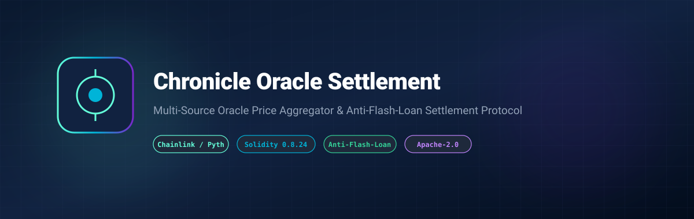

# Chronicle Oracle Settlement Protocol



[](LICENSE)
[](https://soliditylang.org/)
[](https://chain.link)
[](https://www.typescriptlang.org/)

> **A resilient multi-source Oracle price aggregator and anti-flash-loan settlement protocol on EVM.**

---

## 🌟 Overview

Decentralized lending, perp DEXs, and structured product protocols are highly vulnerable to single-source oracle manipulation and flash loan price skewing.

**Chronicle Oracle Settlement** guarantees:
- **Cross-Feed Deviation Bounds**: Strictly cross-references primary (e.g. Chainlink) and secondary (e.g. Pyth / Redstone) feeds; reverts if deviation exceeds threshold (default 500 bps / 5%).
- **Staleness Heartbeat Checks**: Guarantees round timestamps are within acceptable maximum age windows.
- **Client-Side Deviation Auditor**: TypeScript module for real-time price monitoring and anomaly detection.

---

## 🚀 Quick Start

```bash
npm install
npm run test
npm run build
```

---

## 📄 License

Licensed under the Apache License, Version 2.0. See [LICENSE](LICENSE) for details.